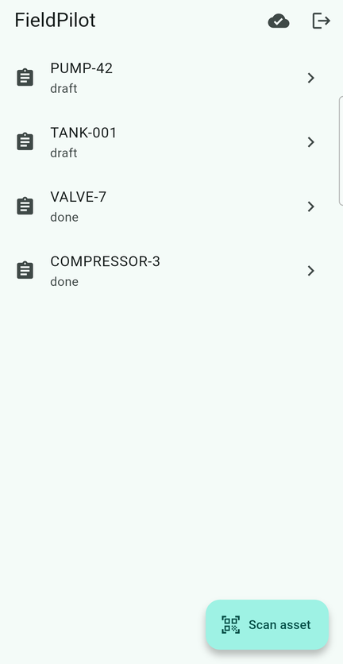
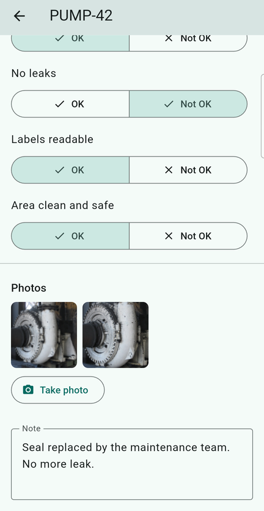
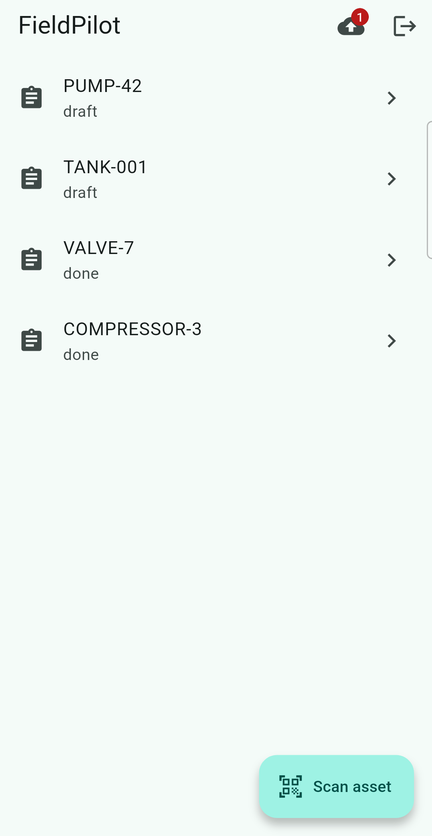
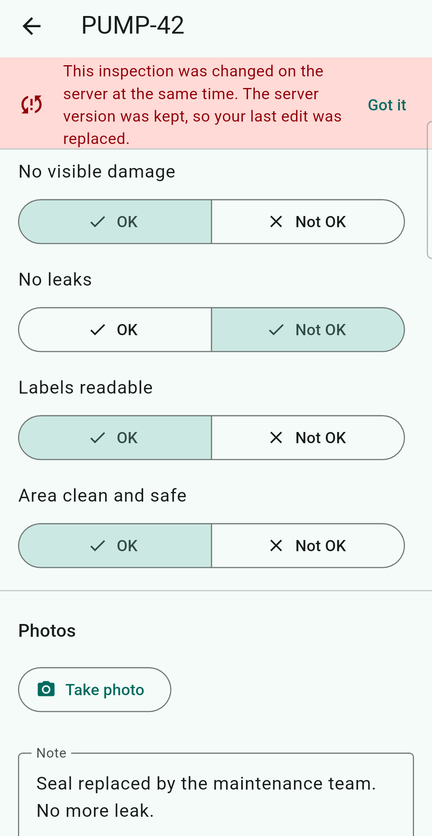

# FieldPilot

An **offline-first** Flutter app for field inspections. Scan an asset's QR code, fill in a checklist, take photos and add a note, with or without internet. Everything is saved on the phone first and synced with Supabase when a connection is available.

<p>
  
  
  
  
</p>

| Screen | What it shows |
|---|---|
| Inspections | Every inspection, saved on the phone. The cloud icon shows how many changes are waiting to sync. |
| Checklist | OK / Not OK per question, photos and a note. Every tap is saved locally right away. |
| Offline | No network: work goes on, and changes wait in an outbox (badge **1**). |
| Conflict | Someone changed the same inspection on the server. The server wins, and the user is told with a banner. |

## Features

- **QR scan** to open an asset's inspection (or reuse its open draft), with zoom for small codes.
- **Works fully offline**: local SQLite database (Drift) is the source of truth for the UI.
- **Automatic sync**: changes are pushed a few seconds after editing, when the app comes back to the screen, or with a tap on the cloud.
- **Pull**: changes made on the server come down to the phone; an empty phone gets all its data back after signing in.
- **Conflicts**: server wins, and the user sees a banner instead of losing an edit silently.
- **Auth**: email + password with Supabase Auth; Row Level Security so each user only sees their own rows.

## How sync works

```
 UI ──► local DB ──► outbox ──push──► push_op (Postgres function) ──► tables
  ▲         ▲                                                          │
  └─────────┴──────────────── pull (changed since cursor) ◄────────────┘
```

1. **Transactional outbox.** Every edit writes the row *and* an outbox entry in one local transaction, so a change can never be saved without being queued.
2. **Idempotent push.** Each entry has an operation id. The server records it with its answer, so a resend (e.g. the app was killed before the reply) is never applied twice and gets the same answer back.
3. **Optimistic versioning.** Each inspection has a version. If the server's version is newer than the one the phone edited, the server keeps its copy and returns it; the phone takes it and shows the conflict banner.
4. **Retries with backoff.** Network errors keep the entry and retry after 5s, 10s, 20s ... up to 5 minutes. Changes the server refuses for good are removed so they can't block the queue.
5. **Incremental pull.** The server stamps every write (`synced_at`, set by a trigger). The phone keeps a cursor per table and asks only for newer rows, with a small overlap so nothing is missed.

## Tech stack

| Area | Choice |
|---|---|
| App | Flutter, Riverpod |
| Local database | Drift (SQLite) with schema migrations |
| Backend | Supabase: Postgres, Auth, Row Level Security |
| Scanning / camera | mobile_scanner, image_picker |
| Tests | flutter_test, fake_async, in-memory Drift, fake servers |

## Run it

1. Create a Supabase project and run the SQL files in [`supabase/migrations/`](supabase/migrations/) in order (SQL Editor).
2. Put your project URL and **publishable** key in [`lib/data/remote/supabase_config.dart`](lib/data/remote/supabase_config.dart). Never put the secret key in the app.
3. Run the app and the tests:

```sh
flutter pub get
flutter run
flutter test
```

## Status

- [x] Offline core: scan, checklist, photos, note
- [x] Sync: outbox, idempotent push, retries, pull, conflict banner
- [ ] Photo upload to Supabase Storage
- [ ] AI findings from the inspection, reviewed and approved by the user
- [ ] CI with GitHub Actions

## Credits

The pump photo in the screenshots is "Warman centrifugal pump" by Bernard S. Janse, [Wikimedia Commons](https://commons.wikimedia.org/wiki/File:Warman_centrifugal_pump.jpg), [CC BY 2.5](https://creativecommons.org/licenses/by/2.5). All inspection data in the screenshots is made-up demo data.
